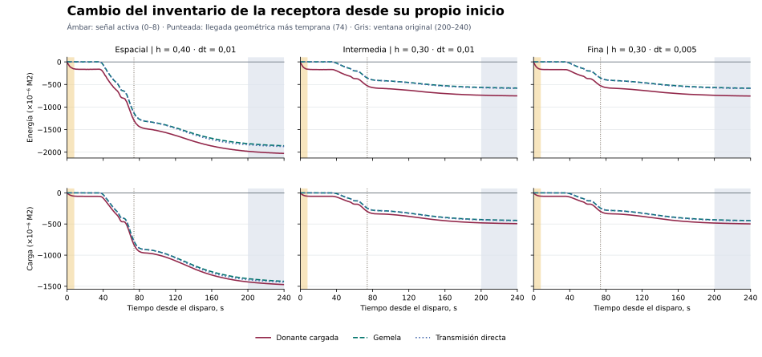
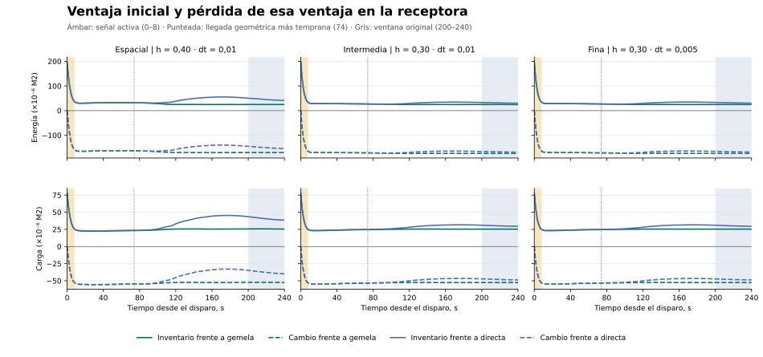
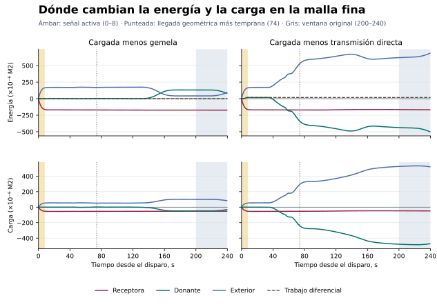

# Primera descarga de la Reserva · diagnóstico de las trayectorias

La receptora ya contenía más energía y carga en el montaje con la donante cargada antes de encender la señal. Desde la primera muestra posterior al disparo pierde parte de esa ventaja. En la malla fina, frente a la gemela, conserva en promedio el 12,66 % de la ventaja energética inicial y el 32,66 % de la ventaja en carga durante s = 200…240. El saldo negativo describe una pérdida relativa. El inventario bruto sigue por encima del control en las 241 muestras. La retención del núcleo donante hasta τ300 y el fracaso de la primera entrega en la ventana registrada son resultados compatibles. [Informe original](../paso3_20261118/INFORME_DESCARGA.md)

## Qué se midió

Se reutilizó el [recibo de los 18 archivos](../paso3_20261118/RECIBO_GUARDADO_DESCARGA.json) del commit `8a032793e8551e4cbc8b94ff99756741b99ca09a`. Se cotejaron las nueve series con el manifiesto y se reprodujeron las 54 medias de inventario de la receptora, los cuatro contrastes y sus variaciones a partir de los CSV. Para este diagnóstico bastaron los inventarios guardados. Las magnitudes son de M2 y las tablas de inventarios están expresadas en millonésimas, salvo indicación contraria. Las medias son integrales trapezoidales divididas por la duración.

Para cada montaje y magnitud X se calculó el cambio G(s) = X(s) − X(0). Para cada control se calcularon también la ventaja bruta B(s) = X_cargada(s) − X_control(s) y el contraste D(s) = G_cargada(s) − G_control(s) = B(s) − B(0). Cada núcleo tiene radio 40.

## Cuándo empieza la pérdida

Las 240 muestras posteriores a s = 0 dan D < 0 para E y Q, frente a cada control y en cada malla. La cadencia de una unidad sitúa la aparición observada entre 0 y 1. En la malla fina, en s = 1 las diferencias frente a la gemela son −46,873 en energía y −15,137 en carga. Al terminar la señal en s = 8 ya son −163,835 y −53,073. Equivalen al 94,70 % y 101,13 % de la magnitud del déficit medio tardío. Esa fracción de carga supera el 100 % porque la curva recupera una pequeña parte después.

Los centros están separados 120. Desde el extremo de la fuente de radio 6 hasta el borde próximo de la receptora de radio 40 quedan 74 unidades. A velocidad máxima uno, s = 74 es el primer contacto geométrico posible en el continuo. El descenso inicial precede ampliamente a ese límite. Las colas y el paquete exterior fueron incorporados al construir los campos en s = 0. Los inventarios integrados no asignan una fracción del saldo a una componente individual del campo ni identifican una trayectoria de flujo.

| Malla | Control | E bruta inicial → media → s240 | Erosión media E | Q bruta inicial → media → s240 | Erosión media Q |
|---|---|---:|---:|---:|---:|
| Espacial | Gemela | 194,767 → 25,141 → 24,883 | 87,09 % | 77,958 → 25,668 → 25,435 | 67,07 % |
| Intermedia | Gemela | 198,087 → 24,869 → 24,706 | 87,45 % | 77,933 → 25,454 → 25,308 | 67,34 % |
| Fina | Gemela | 198,087 → 25,075 → 24,920 | 87,34 % | 77,933 → 25,455 → 25,308 | 67,34 % |
| Espacial | Directa | 195,027 → 45,193 → 41,277 | 76,83 % | 78,247 → 40,636 → 38,500 | 48,07 % |
| Intermedia | Directa | 198,348 → 31,357 → 30,082 | 84,19 % | 78,222 → 30,181 → 29,543 | 61,42 % |
| Fina | Directa | 198,348 → 31,548 → 30,296 | 84,09 % | 78,222 → 30,170 → 29,553 | 61,43 % |

## Qué ocurre alrededor de la receptora

En s = 8, frente a la gemela, el exterior gana +164,278 de energía y +53,263 de carga mientras la receptora pierde −163,835 y −53,073. La donante presenta cambios diferenciales pequeños (−0,198 y −0,190). En ambas ramas se hizo casi el mismo trabajo. En la malla fina el trabajo acumulado alcanza +17,926928 con la cargada, +17,925542 con la gemela y aproximadamente cero con transmisión directa. Permanece constante desde s = 8. La diferencia de trabajo cargada−gemela es +0,001386 millonésimas. La fuente escalar conserva la carga global. [Definición de la señal y del trabajo](../paso3_20261118/DISENO_DESCARGA.md)

La tabla recoge la media de s = 200…240 en la malla fina. Las filas de cada montaje usan su propio inventario inicial. Por eso también se puede leer cuánto de la salida al exterior aparece en los controles.

| Montaje o diferencia | E donante | E receptora | E exterior | Q donante | Q receptora | Q exterior |
|---|---:|---:|---:|---:|---:|---:|
| Cargada | −447,507 | −749,434 | +1215,415 | −477,128 | −492,200 | +969,329 |
| Gemela | −569,885 | −576,422 | +1164,474 | −432,038 | −439,722 | +871,760 |
| Directa | +5,880 | −582,635 | +576,876 | +4,522 | −444,149 | +439,627 |
| Cargada − gemela | +122,378 | −173,012 | +50,941 | −45,090 | −52,478 | +97,568 |
| Cargada − directa | −453,387 | −166,799 | +638,539 | −481,650 | −48,052 | +529,702 |

En la directa, «donante» designa el mismo volumen geométrico con el centro inicialmente vacío. En la lectura tardía, frente a la gemela, la diferencia entre las energías globales ganadas es +0,306 millonésimas. La diferencia entre los trabajos es +0,001386. La diferencia restante es compatible con los residuos globales de la integración. El máximo individual de |ΔE−W| en las ramas finas es 1,323 millonésimas y el de |ΔQ| es 0,000113 millonésimas. Los inventarios regionales muestran redistribución y no miden flujos dirigidos desde una gota a la otra. [Balances por tiempo y malla](DIAGNOSTICO.json)

## Qué se cancela al cambiar de malla

**Proyección inicial.** Para una gota aislada se comparó el mismo campo antes y después de mapearlo al cilindro. Sea b el cambio cilíndrico menos radial. Al comparar dos donantes queda δb = b_cargada − b_gemela. La fracción cancelada es 1 − |δb|/|b_gemela|. Esta tabla está en **unidades M2**, sin factor de un millón.

| h | Medida | b gemela | δb cargada−gemela | Fracción cancelada |
|---:|---|---:|---:|---:|
| 0,30 | E del núcleo | +0,280701081 | −3,186 × 10⁻⁸ | 99,999989 % |
| 0,30 | Q del núcleo | +0,388190737 | −2,162 × 10⁻⁷ | 99,999944 % |
| 0,40 | E del núcleo | +0,502504974 | −5,797 × 10⁻⁸ | 99,999988 % |
| 0,40 | Q del núcleo | +0,694434005 | −3,867 × 10⁻⁷ | 99,999944 % |
| 0,30 | E de toda la caja | +0,280701081 | −0,01265965 | 95,4900 % |
| 0,40 | E de toda la caja | +0,502504975 | −0,02185989 | 95,6498 % |

En la caja completa la carga cancela más del 99,99994 % en ambos pasos. En cambio, la energía adicional de toda la caja pasa de 0,33801747 en radial a 0,32535782 (h = 0,30) o a 0,31615758 (h = 0,40). Esto supone reducciones del 3,75 % y 6,47 % de ese exceso físico. El dato del núcleo sólo describe la proyección aislada.

La receptora aislada es idéntica en las tres configuraciones, incluida la directa. Su proyección en h = 0,30 añade +0,280701101 de E y +0,388190776 de Q al núcleo. Esa contribución común inicial desaparece algebraicamente al comparar montajes. Al superponer las gotas, el inventario incluye las colas y los términos de interacción. La ventaja inicial de +0,000198087 y +0,000077933 frente a la gemela **sí** se mide en estos campos superpuestos. En el control directo falta toda la donante, por lo que atribuirle el residual de mapeo de dos donantes aisladas sería incorrecto. [Inventarios aislados antes y después de mapear](../paso3_20261118/RESULTADO_DESCARGA.json)

**Evolución a dos resoluciones.** A dt = 0,01, refinar h de 0,40 a 0,30 cambia la ganancia media de la rama cargada en +1261,410 millonésimas de E y +965,200 de Q. Frente a la gemela quedan −3,593 y −0,189, lo que cancela el 99,72 % y el 99,98 % del cambio en la rama cargada. Frente a la directa quedan −17,157 y −10,430, con cancelaciones del 98,64 % y 98,92 %. Estos residuos de evolución fijaron la incertidumbre original. Los porcentajes de la proyección en s = 0 miden otra cantidad.

## Dictamen y decisión

| Control | D de energía ± U | D de carga ± U |
|---|---:|---:|
| Gemela | −173,012 ± 3,593 | −52,478 ± 0,189 |
| Directa | −166,799 ± 17,157 | −48,052 ± 10,430 |

**0 de 4** superaron D > 3U. Los cuatro mantienen el signo negativo aun sumando 3U. Esta conclusión se limita a la geometría, preparación, señal y ventana originales. El diagnóstico por sí solo deja abierta la contribución del disparo después de su posible llegada y cuánto de esa contribución comparte la gemela. Se abre una misión independiente de señal apagada para medir ambas cantidades. La recarga y la segunda descarga requieren demostrar antes una primera entrega útil. [Prerregistro del contraste causal](../mision_senal_apagada_20261124/PRERREGISTRO.md)

Para reproducir las cuentas y las tres figuras desde este directorio, ejecutar `python diagnosticar.py` con NumPy 2 y Matplotlib. Los CSV, el resultado de referencia y el manifiesto se leen del directorio hermano. [Código](diagnosticar.py) · [Cuentas sin redondear](DIAGNOSTICO.json)
