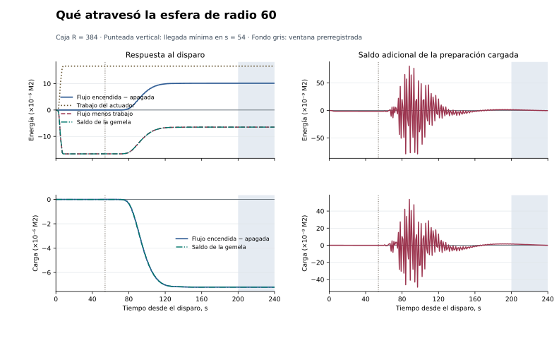
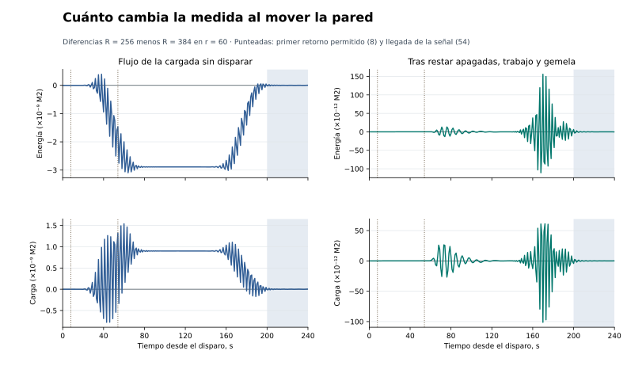

# Paso 3 · ¿la señal extrae energía y carga de la donante?

**La donante envió energía a través de r = 60, pero la señal gastó más energía que el incremento de flujo que produjo. Al descontar el trabajo y la respuesta de la gemela, no se resolvió una extracción conjunta de energía y carga almacenadas.** En la ventana registrada, una salida adicional positiva mayor que el 0,00613 % del exceso energético o el 0,00103 % del exceso de carga habría superado las respectivas cotas numéricas. El objetivo era el 1 % en cada magnitud. Este dictamen se limita a la señal y la preparación ensayadas. [Prerregistro anterior al cálculo](https://github.com/diegolezaval/Proyecto_Runas/blob/71057af265e24566f15c2c4858c6fb7dd9bc5f05/checkpoints/Reserva/mision_extraccion_radial_20261124/PRERREGISTRO.md) · [Resultado sin redondear](RESULTADO.json)

## Lo que cruzó las dos esferas

Se ejecutaron cuatro casos en cinco réplicas de caja o resolución. Los flujos son acumulados desde el disparo, con signo positivo hacia fuera. La tabla muestra la media de esos acumulados en s = 200…240 (τ = 500…540), para R = 384, h = 0,025 y dt = 0,0005. Las cifras están en **millonésimas de unidades M2**. El trabajo alcanzó su valor final en s = 8 y la fuente neutra aportó cero carga.

| Donante | Señal | E que cruzó r40 | Q que cruzó r40 | E que cruzó r60 | Q que cruzó r60 | Trabajo efectivo |
|---|---|---:|---:|---:|---:|---:|
| Cargada | Encendida | +11,211100 | −6,169058 | +16,437381 | −1,174600 | +16,644426 |
| Cargada | Apagada | +1,056951 | +1,038060 | +6,281816 | +6,030475 | 0 |
| Gemela | Encendida | +10,154117 | −7,206059 | +10,153708 | −7,205772 | +16,643029 |
| Gemela | Apagada | +0,000051 | +0,000047 | +0,000010 | +0,000008 | 0 |

En r60 la donante cargada emitía espontáneamente +6,281816 de energía. Encender la señal añadió +10,155564 al flujo. El actuador entregó +16,644426, de modo que el saldo energético de extracción fue −6,488861. El flujo de carga disminuyó en 7,205076 al encenderla. Ambos cambios corresponden a **más inventario dentro de r60** respecto a la misma donante apagada.

Por separado, la gemela dio un saldo de −6,489332 en E y −7,205780 en Q. La pequeña diferencia entre las respuestas de ambas gotas es la medida de acceso selectivo a la carga previa. [Series de los veinte recorridos y registro de ejecución](datos/) · [Balances brutos en r40, r60, la corona y la caja](BALANCES.json)



## Incertidumbre y continuidad

Y compara la misma donante encendida y apagada. En E se resta el trabajo total hecho dentro de la esfera. D = Y_cargada − Y_gemela. Las dos esferas se evalúan por separado. La tabla de D se expresa en **milmillonésimas de unidades M2** (10⁻⁹). El intervalo es D ± 3U. U cuantifica la sensibilidad de este ensayo numérico y no lleva una probabilidad estadística asociada.

| Radio | Canal | D | U | D − 3U a D + 3U | Mayor salida positiva compatible, en % del exceso inicial |
|---:|---|---:|---:|---:|---:|
| 40 | Energía | −1,31391 | 3,23981 | −11,03334 a +8,40553 | 0,00505 % |
| 40 | Carga | −1,01251 | 0,17951 | −1,55103 a −0,47399 | 0 % |
| 60 | Energía | +0,47043 | 3,23980 | −9,24896 a +10,18981 | 0,006123 % |
| 60 | Carga | +0,70489 | 0,39680 | −0,48552 a +1,89529 | 0,001026 % |

En r40 la diferencia en carga se resuelve con signo hacia dentro. En r60 los dos intervalos incluyen cero y el saldo Y de la cargada es negativo en ambos canales. En ese radio, las cotas conservadoras |D| + 3U coinciden con los extremos positivos de la tabla. El exceso inicial del núcleo era 1,66414371 × 10⁻⁴ en E y 1,84762579 × 10⁻⁴ en Q. La regla registrada exigía resolver una salida de la cargada y una ventaja frente a la gemela. Los dos criterios fallaron en r60. Hay oscilaciones transitorias antes de s = 200. La media tardía mide qué parte del flujo queda neta al terminar su paso.

Se contrastó el flujo integrado directamente en cada cara con la variación del inventario interior en cada muestra. En r60, el máximo |ΔE + F − W| de las cuatro ramas principales fue 1,593 × 10⁻⁹ M2 (redondeado hacia arriba) y el máximo |ΔQ + F| fue 1,625 × 10⁻¹¹. En la corona entre radios 40 y 60, sin fuente, |ΔX + F60 − F40| fue a lo sumo 1,64 × 10⁻¹² para cualquiera de las dos magnitudes. Al releer los veinte estados finales con suma compensada, los inventarios coincidieron con las series dentro de 9,10 × 10⁻¹³ M2. [Verificación separada de 80 balances, 60 medias y 12 incertidumbres](VERIFICACION.json)

En r60 domina en E la suma conservadora de los errores máximos de cierre de las cuatro ramas (3,240 × 10⁻⁹). En Q domina el cambio entre la ventana principal y sus mitades (3,968 × 10⁻¹⁰). Los máximos prearribo se computaron sobre el flujo encendida−apagada, antes de descontar el trabajo. [Componentes, mitades de ventana y controles](RESULTADO.json) · [Series de Y y D por tiempo y malla](CONTRASTES.csv)

## ¿Contaminaba la reflexión la atribución?

En R = 256 el primer retorno geométrico del pulso antiguo a r60 es posible en τ308, ocho unidades después del disparo. La nueva señal tarda al menos 54 en llegar a r60. Se ejecutaron los cuatro casos en esa caja desde los dos estados originales verificados de τ300. Para las dos cajas amplias se retomó la preparación sin pulso en τ0, se añadió de nuevo el paquete original sólo a la cargada y se volvió a evolucionar hasta τ300. El primer contacto posible del paquete con la pared antigua era τ112. La cola del fondo fino en la última unidad de la caja antigua medía menos de 3 × 10⁻⁴⁹ en campo y velocidad. Los inventarios en r40 y r60 de las dos preparaciones finas ampliadas coincidieron con los históricos en τ300 dentro de 1,10 × 10⁻¹¹ M2. [Preparaciones, pruebas de identidad y reproducción de la calibración](datos/EJECUCION.json)

| Radio de la caja | Retorno del pulso antiguo a r40, s | Retorno a r60, s | Margen en r60 al cerrar en s240 |
|---:|---:|---:|---:|
| 256 | 28 | 8 | La ventana ya admite retornos |
| 384 | 284 | 264 | 24 |
| 416 | 348 | 328 | 88 |

Mover la pared de 256 a 384 produjo una diferencia transitoria medible de hasta 3,095 × 10⁻⁹ en el flujo energético bruto de la cargada apagada en r60 y 1,541 × 10⁻⁹ en el de carga. Ambas superaron por primera vez 10⁻¹⁰ en la muestra s = 29. El primer retorno geométrico es una cota inferior de tiempo y no predice la amplitud de una reflexión. En el **contraste tardío D**, R256 menos R384 dio −1,916 × 10⁻¹⁵ en E y +9,776 × 10⁻¹⁵ en Q. La pared sí movió los flujos brutos transitoriamente y su efecto en la decisión quedó por debajo de U. Entre R384 y R416 el cambio absoluto de D fue 5,44 × 10⁻¹⁷ en E y 1,37 × 10⁻¹⁶ en Q. [Comparación de paredes en las cuatro ramas y sus restas](PARED.json)



## Decisión para la Reserva

**Revisar la señal de extracción.** Comprobar qué perturbación del estado cargado puede acoplar el actuador a un modo que lleve energía y carga hacia fuera. La señal calibrada actual entrega trabajo al sistema y produce respuestas prácticamente iguales en la cargada y en la gemela. El margen ya distingue el objetivo del 1 % en ambos canales. Si se busca estudiar los residuos mucho menores de esta señal, la prioridad en energía sería reducir los errores de cierre, y en carga ampliar la lectura tardía manteniendo el margen contra retornos.

La captura queda pendiente de observar una salida conjunta atribuible a la carga en r60. La primera misión de entrega a la receptora conserva 0/4. La recarga y la segunda descarga siguen condicionadas a una primera entrega útil.

## Recuperación y reproducción

Los cuatro casos físicos se ejecutaron en cinco configuraciones. Se publican 20 series de 241 muestras y las huellas SHA-256 de los 20 estados finales y de los seis estados reconstruidos de τ300 en cajas amplias. Los campos se regeneran desde los insumos radiales del repositorio. El integrador repitió 100 pasos libres con coincidencia exacta al apagar su fuente. En la comprobación radial a dt = 0,001 reprodujo el trabajo de la calibración publicada con diferencia absoluta 4,37 × 10⁻¹⁶ o menor. Las 20 trayectorias postdisparo suman 7.680.000 pasos. La preparación, la evolución y la comprobación de campos durante el cálculo duraron 124,5 segundos.

Desde este directorio se pueden regenerar las cuentas y las figuras con NumPy 2 y Matplotlib. Para remedir los estados se requiere también el modelo del repositorio. Para repetir la preparación y la evolución hacen falta SciPy y un compilador C.

```sh
python balances.py
python figuras.py
python verificar.py
OPENBLAS_NUM_THREADS=1 python ejecutar.py salida_nueva --jobs 8
python balances.py salida_nueva --salida resultados_nuevos
python verificar.py salida_nueva --resultados resultados_nuevos --estados
```

[Integrador](ejecutar.py) · [Fuente de χ y trabajo](senal.c) · [Cálculo de los balances](balances.py) · [Verificación independiente](verificar.py) · [Huellas de los insumos y de los estados regenerables](datos/EJECUCION.json)
