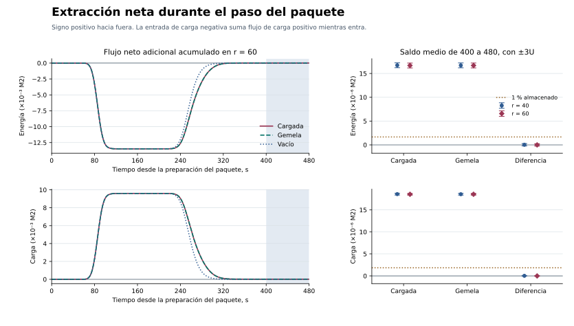
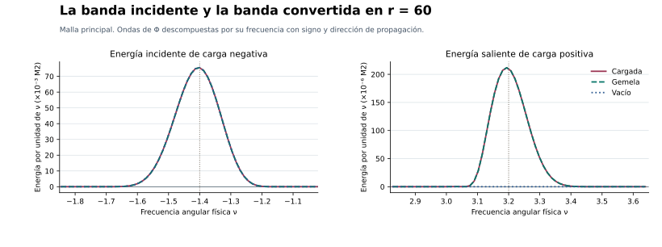

# Reserva · extracción con un paquete de carga negativa

**Dictamen del paso 3.** El paquete en Φ produjo una banda saliente de carga positiva centrada en **+3,20593** y extrajo energía y carga de las dos donantes. En r = 60 la gemela entregó 16,6804 millonésimas de energía M2 y 18,5429 de carga M2. La diferencia cargada menos gemela abarca el cero en ambos canales. La máxima extracción positiva compatible con las cotas es **0,14976 % del exceso de energía almacenado y 0,01334 % del exceso de carga**. El ensayo descarta el objetivo del 1 % para esta preparación, amplitud y fase. La captura de una salida atribuible a la carga previa sigue pendiente. La recarga requiere demostrar una entrega útil a la receptora. [Prerregistro](PRERREGISTRO.md) · [Dictamen y cotas por radio](RESULTADO.json)

## Cuánto perdió cada donante

Cada lectura es la media trapezoidal del flujo acumulado entre s = 400 y 480. Para cada donante, Y es el flujo con paquete menos el flujo de esa misma donante sin paquete. D es Y de la cargada menos Y de la gemela. El signo positivo indica salida. El flujo ya contabiliza el paso incidente y el trabajo externo posterior es cero. La tabla expresa cada magnitud en millonésimas de su unidad M2. Las barras ±3U representan cotas numéricas.

| Radio | Canal | Y gemela ±3U | Y cargada ±3U | D ±3U | D por pérdida de inventario |
|---:|---|---:|---:|---:|---:|
| 40 | Energía | 16,69572 ± 0,51451 | 16,71737 ± 0,51449 | +0,02165 ± 0,25718 | +0,02162 |
| 40 | Carga | 18,55249 ± 0,19655 | 18,57562 ± 0,19627 | +0,02313 ± 0,00169 | +0,02310 |
| 60 | Energía | 16,68042 ± 0,51455 | 16,67243 ± 0,51453 | −0,00799 ± 0,25721 | −0,00802 |
| 60 | Carga | 18,54295 ± 0,19660 | 18,53667 ± 0,19459 | −0,00627 ± 0,03091 | −0,00631 |

En r = 60, las pérdidas adicionales de inventario interior de la gemela fueron 16,68046 en energía y 18,54298 en carga. Las de la cargada fueron 16,67244 y 18,53667. En r = 40 se obtuvieron 16,69576 y 18,55252 para la gemela, y 16,71738 y 18,57562 para la cargada. En los doce contrastes, incluidos los cuatro D, la mayor diferencia entre las medias por flujo e inventario fue 3,91 × 10⁻¹¹ M2. [Inventarios, flujos brutos por caso y balances de la corona 40…60](BALANCES.json)

En r = 40 se resolvió un exceso positivo de carga. La energía diferencial en esa esfera y los dos canales diferenciales en r = 60 incluyen el cero. La incertidumbre dominante de D en r = 60 procede de la suma de residuos individuales de continuidad para la energía y de las dos mitades de la ventana para la carga. Para el desacuerdo puntual entre flujo e inventario y los cambios entre mitades se tomó el máximo de las cuatro réplicas de lectura completa. El registro conserva también U calculada restringiendo esos dos controles a la malla principal. Con esa convención la cota positiva de carga en r = 60 es 0,01324 %.

| Cota en r = 60 | Energía M2 | % del exceso energético | Carga M2 | % del exceso de carga |
|---|---:|---:|---:|---:|
| Máxima salida positiva, D + 3U | 2,49221 × 10⁻⁷ | 0,14976 % | 2,46356 × 10⁻⁸ | 0,01334 % |
| Máxima magnitud, abs(D) + 3U | 2,65196 × 10⁻⁷ | 0,15936 % | 3,71838 × 10⁻⁸ | 0,02013 % |
| Umbral prerregistrado | 1,66414 × 10⁻⁶ | 1 % | 1,84763 × 10⁻⁶ | 1 % |

Los porcentajes usan el exceso histórico medido en r = 40 en τ300. Las cotas superiores de la tabla se redondean hacia arriba. La equivalencia de las preparaciones al nivel del 1 % se cumple en los dos radios. [Exceso original y predicción lineal](DISENO_ESPECTRAL.json)



## Qué onda salió

Sobre la preparación de τ300 se superpuso el paquete finito en 96 < r < 144 con amplitud 0,00456, frecuencia física −1,4 y la fase fijada en el prerregistro. En vacío aportó E = 0,01349374206 y Q = −0,00960277812. En la cargada, el término cruzado inicial fue +7,530 × 10⁻⁸ en E y +6,508 × 10⁻⁸ en Q. En la gemela fue +1,070 × 10⁻¹¹ y +1,026 × 10⁻¹¹, respectivamente. Los inventarios iniciales emparejados coincidieron dentro de las dos caras.

La descomposición direccional de las dos celdas vecinas de cada cara se aplicó a la perturbación compleja con paquete menos sin paquete. La banda de +2,82 a +3,65 de la gemela transportó hacia fuera **29,62713** millonésimas de energía y **9,24398** de carga en r = 60. Para la cargada se obtuvieron **29,62717** y **9,24399**. En vacío, la energía en esa banda fue 1,47 × 10⁻¹⁶ M2. Las cotas 3U de banda fueron como máximo 0,294 y 0,099 millonésimas en energía y carga. Ambas donantes superaron el control de vacío y su propia entrada positiva en ambos radios. La conversión observada concuerda con la prevista en +3,2.

La banda negativa de la gemela pasó de 0,01349372 M2 de energía entrante a 0,01348072 saliente en r = 60. Esta caída permite que la energía bruta de la banda positiva sea mayor que la extracción neta. Se conservan también las restas espectrales de las trazas completas y los términos de interferencia pueden recuperarse comparándolas con la perturbación. [Bandas, interferencia y cortes de traza](BANDAS.json) · [Espectro direccional con signo](ESPECTRO.csv)



## Cobertura y conservación

Se ejecutaron cinco casos físicos por configuración con el integrador radial M2 de Verlet y sus flujos de volúmenes finitos. Los seis estados de τ300 regenerados desde la preparación de τ0 reprodujeron exactamente los campos y velocidades en r ≤ 144 y los cuatro inventarios interiores de las referencias certificadas. Entre R416 y R512, en el tramo común s = 0…300, el mayor cambio de flujo bruto fue 9,55 × 10⁻¹⁷ M2. En la malla principal los mayores residuos globales fueron 4,21 × 10⁻⁸ en energía y 2,23 × 10⁻¹¹ en carga. En la corona 40…60 fueron 7,51 × 10⁻¹⁰ y 1,81 × 10⁻¹². [Preparaciones y huellas](datos/EJECUCION.json) · [Solapamiento, cierres y tiempos de retorno](BALANCES.json)

| Configuración | R | h | dt | Última muestra s | Primer retorno histórico posible a r = 60 |
|---|---:|---:|---:|---:|---:|
| Solapamiento | 416 | 0,025 | 0,0005 | 300 | 328 |
| Principal | 512 | 0,025 | 0,0005 | 480 | 520 |
| Temporal | 512 | 0,025 | 0,001 | 480 | 520 |
| Espacial | 512 | 0,05 | 0,001 | 480 | 520 |
| Segunda caja | 576 | 0,025 | 0,0005 | 480 | 648 |

Pasaron los 80 controles de cobertura. En vacío, la mayor discrepancia relativa entre la energía inicial y la banda negativa entrante o saliente fue 0,000185 %, frente al límite de 0,5 %. Los mayores residuos brutos en r = 60 fueron 2,52 × 10⁻⁸ en E y 2,21 × 10⁻⁸ en Q. El mayor cambio de energía de banda entre s = 440 y 480 consumió menos de 0,0066 % de su tolerancia. La ventana de 400…480 bastó para decidir. La extensión condicional a 560…640 quedó sin activar.

## Recuperación y reproducción

Se recuperaron 21 trayectorias completas. Se volvieron a ejecutar desde τ300 las cuatro ramas de donante de R576 y sus ocho prefijos de series y sondas coincidieron byte por byte. Esta recuperación duró 121,1 s. El reloj completo de la primera ejecución se perdió. Una repetición íntegra en otro directorio, con ocho trabajadores, regeneró las seis preparaciones amplias y repitió los 17 400 000 pasos posteriores a τ300 en 322,2 s. Se obtuvieron las mismas huellas SHA-256 para las 50 series, los 25 estados finales y las seis preparaciones. [Prefijos recuperados](datos/RECUPERACION.json) · [Repetición completa](REPRODUCCION.json) · [Recibo de los 25 casos repetidos](datos/EJECUCION_REPETICION.json)

La verificación independiente reconstruyó las 144 medias de ventana, las doce sensibilidades y 576 flujos de banda por transformada discreta directa y solución de dos ecuaciones complejas. Al remedir los 25 estados finales, el máximo desacuerdo en inventarios fue 1,37 × 10⁻¹² M2. [Verificación](VERIFICACION.json) · [Series y campos](datos) · [Huellas de la misión](SHA256SUMS)

Para rehacer las lecturas desde este directorio se requieren Python 3.12 y las versiones de NumPy y SciPy fijadas en el repositorio. Las figuras usan Matplotlib. La evolución se verificó con GCC 14.2 y las opciones del integrador radial original.

```sh
OPENBLAS_NUM_THREADS=1 python medir.py
OPENBLAS_NUM_THREADS=1 python verificar.py
python figuras.py
```

El [ZIP de reproducción](Reserva_paquete_negativo_reproducible.zip) incluye el código, todos los insumos físicos, las cuatro referencias históricas de τ300, las series y los balances. Al descomprimirlo, ejecutar `sha256sum -c HUELLAS_PAQUETE.sha256` en su raíz. En la rama también se pueden descargar directamente los seis estados ampliados y los 25 estados finales. Para regenerarlos desde la carpeta de la misión y comprobar sus huellas:

```sh
OPENBLAS_NUM_THREADS=1 python simular.py corrida_nueva --preparaciones datos/referencias_tau300 --jobs 8
python cotejar_repeticion.py corrida_nueva
OPENBLAS_NUM_THREADS=1 python verificar.py corrida_nueva --campos
```
