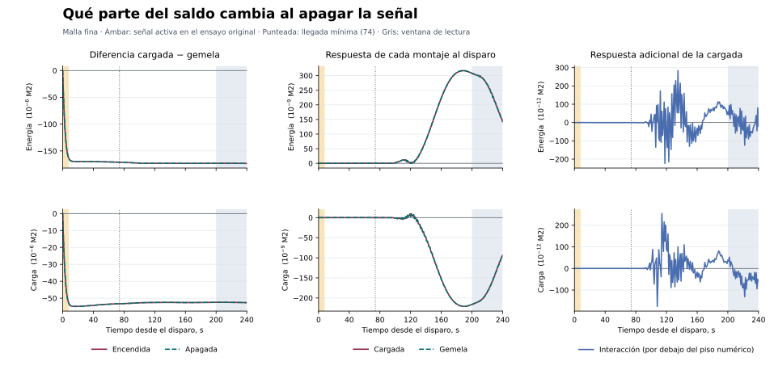

# Reserva · qué cambia al apagar la señal

**El déficit de la receptora frente a la gemela aparece también sin disparar.** En la malla fina, la pérdida diferencial media entre s = 200 y 240 es de 173,012 millonésimas de energía y 52,478 de carga tanto con la señal encendida como apagada, a la precisión mostrada. El criterio de equivalencia prerregistrado se cumple en ambos canales, incluso al incorporar los residuos globales. El efecto específico del disparo sobre lo que distingue a la donante cargada de la gemela es inferior al 10 % del déficit con la sensibilidad ensayada. [Prerregistro publicado antes de integrar](https://github.com/diegolezaval/Proyecto_Runas/blob/561874fa850fbc7d93a85a9f7d43d99df8dabdd0/checkpoints/Reserva/mision_senal_apagada_20261124/PRERREGISTRO.md)

La primera misión conserva su dictamen de **0/4** contrastes de entrega útil. La retención ya demostrada hasta τ300, del 96,90 % de la energía adicional y el 97,41 % de la carga adicional en la malla fina, continúa siendo un resultado distinto. [Retención](../paso3_20261118/RETENCION.json) · [Dictamen funcional y diagnóstico de la primera descarga](../diagnostico_primera_descarga_20261124/README.md)

## Ensayo y resultados

Se reutilizaron las seis series encendidas de la cargada y la gemela. Se simularon sus seis equivalentes con A = 0 en tres discretizaciones, desde los mismos campos radiales de partida. Se midió cada núcleo respecto a su propio inventario en s = 0. De los campos finales se volvieron a obtener los ocho inventarios publicados en la última fila de cada serie, con diferencia máxima cero. En todos los pares coincidieron exactamente los inventarios iniciales y las dos lecturas de la receptora en las 61 muestras de s = 0…60. El trabajo apagado fue cero en todas las muestras. La integración y la verificación de sus seis estados duraron 282,7 segundos. [Series, orígenes y recibo](datos/) · [Integrador de la misión](ejecutar.py)

Para E y Q, D mide el cambio de la cargada menos el de la gemela. P mide cuánto cambia la misma preparación al encender la señal. I = P_cargada − P_gemela = D_encendida − D_apagada mide la contribución del disparo que depende de la carga previa. Todas las cifras de las dos tablas están en **millonésimas de unidades M2**. U representa sensibilidad numérica al cambio de malla, paso temporal y ventana, con el control temprano y el piso especificados en el prerregistro.

| Media en s = 200…240, malla fina | E | U(E) | Q | U(Q) |
|---|---:|---:|---:|---:|
| D encendida, ensayo original | −173,011978 | 3,592542 | −52,478271 | 0,188774 |
| D apagada, ensayo nuevo | −173,011975 | 3,592483 | −52,478235 | 0,188705 |
| P cargada | +0,251747 | 0,101283 | −0,173083 | 0,065053 |
| P gemela | +0,251750 | 0,101225 | −0,173047 | 0,065122 |
| I, efecto adicional del disparo | −0,0000028 | 0,002000 | −0,0000359 | 0,002000 |

Las estimaciones de P son muy parecidas en ambas preparaciones. En cada caso |P| queda por debajo de 3U para ambas magnitudes. El signo del cambio medio que la señal produce en una sola receptora queda sin resolver con este conjunto de mallas. En el contraste entre preparaciones, el piso numérico domina U(I). Los dígitos adicionales de la tabla se dan para reproducir la sustracción.

| Canal | D apagada + 3U | Umbral material del 10 % | Límite principal de la magnitud de I, con 3U | Límite con residuos globales | Fracción del déficit en la prueba conservadora |
|---|---:|---:|---:|---:|---:|
| Energía | −162,235 | 17,3012 | 0,006003 | 14,88865 | 8,61 % |
| Carga | −51,912 | 5,24783 | 0,006036 | 0,006036 | 0,0115 % |

La suma de los cuatro residuos finos máximos fue de 4,962881 millonésimas de E y 0,000421 millonésimas de Q. E fija el caso más exigente y aun así el límite de 14,889 queda por debajo de 17,301. Estas cifras son comprobaciones de sensibilidad numérica en la configuración ensayada. En los cuatro montajes finos, los residuos de partición por regiones quedaron por debajo de 5 × 10⁻¹² unidades M2. [Decisión y sensibilidades por malla](RESULTADO.json) · [Contrastes muestra a muestra](CONTRASTES_POR_TIEMPO.csv)

## Qué aprendimos y qué corresponde hacer

La receptora empezó con parte del campo exterior de la donante dentro de su núcleo. La mayor parte de esa ventaja se perdió antes de que pudiera llegar la señal. El contrafactual con A = 0 muestra que el déficit tardío surge de la evolución de esa preparación. El balance por sí solo no permite asignar la pérdida a una componente concreta del campo ni seguir qué porción atravesó la receptora. La entrega neta positiva de energía y carga sigue pendiente. [Medida directa del solapamiento en s = 0](../diagnostico_primera_descarga_20261124/SOLAPAMIENTO_INICIAL.json)

El siguiente ensayo de diseño debería localizar dónde falla la entrega. Se puede empezar en la donante aislada y medir el flujo neto de energía y carga que atraviesa los radios 40 y 60 al disparar. Conviene comparar cargada y gemela, cada una con señal encendida y apagada, registrar el trabajo de la fuente y cotejar el flujo con la pérdida del núcleo. Así se distinguiría una extracción insuficiente de una descarga que sí sale pero que la receptora distante no captura. Volver a la receptora requiere una señal de salida atribuible a la carga. **La recarga y la segunda descarga siguen condicionadas a demostrar una primera entrega útil.**

## Reproducción

Con NumPy 2 y Matplotlib, desde este directorio, `python analizar.py` regenera la tabla por tiempo, la figura y el resultado desde las series verificadas. Con SciPy y un compilador C, `OPENBLAS_NUM_THREADS=1 python ejecutar.py salida_nueva --jobs 6` regenera también los seis campos finales y sus velocidades. Los hashes SHA-256 de esos estados se conservan en el recibo de ejecución. Para esta misión bastaron los tres estados radiales iniciales y el archivo histórico del ZIP en s = 240 permaneció sin descargar.

El paquete autónomo contiene las nueve series encendidas, las seis apagadas, los tres estados radiales de partida, el código, los informes y las figuras. [Descargar paquete reproducible](Reserva_contraste_senal_reproducible.zip) · [Análisis](analizar.py) · [Recibo de ejecución](datos/EJECUCION.json)
