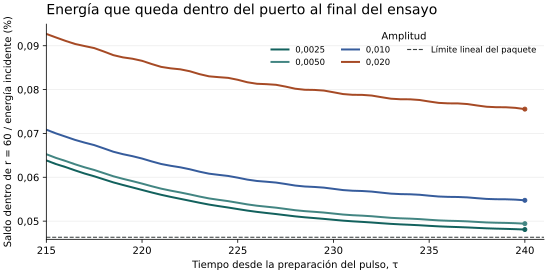

# Paso 2 · dominio medido de la Reserva

**El contraste habilita diseñar el ciclo del paso 3.** La Q-ball M2 preparada con $\omega=0,9$ recibió energía y carga en los tres puntos $a=0,0025$, $0,0050$ y $0,010$. Son pulsos esféricos con la misma portadora, envolvente y fase, después de una preparación controlada. La medición termina en $\tau=240$. La mayor discrepancia de fracción absorbida entre las tres parejas fue **12,18 %** con límite de **25 %**. El primer par 0,010–0,020 mantiene su resultado negativo de 27,54 %. [Decisión y presupuestos](RESULTADO.json) · [Primer checkpoint](../INFORME.md)

## Mediciones del contacto

Las cifras corresponden a la malla fina $\Delta r=0,025$, $\Delta t=0,001$. Se integra el flujo por $r=60$ y se sustrae el gemelo preparado sin pulso. El cociente de energía se refiere al paquete que entró. La energía estructural de la preparación fue 2525,633310 y su carga 2745,746206. [Fuente, trabajo y estabilidad del núcleo](../INFORME.md)

| Amplitud | E incidente | E reflejada | E absorbida al cierre | Q absorbida al cierre | E absorbida / incidente |
|---:|---:|---:|---:|---:|---:|
| 0,0025 | 0,021126064 | 0,021115907 | 0,000010157 | 0,000010754 | 0,048077 % |
| 0,0050 | 0,084504256 | 0,084462497 | 0,000041760 | 0,000044153 | 0,049417 % |
| 0,010 | 0,338017025 | 0,337831974 | 0,000185050 | 0,000194699 | 0,054746 % |
| 0,020, primer ensayo | 1,352068097 | 1,351046635 | 0,001021462 | 0,001060557 | 0,075548 % |

| Amplitud aprobada | Aumento de E del núcleo $r<40$ | Aumento de Q del núcleo | Cambio relativo de $\lvert\Phi\rvert$ del núcleo | Cambio relativo de χ del núcleo | Señal E / $U_E$ | Señal Q / $U_Q$ |
|---:|---:|---:|---:|---:|---:|---:|
| 0,0025 | 0,000009847 | 0,000010925 | $2,05\times10^{-6}$ | $8,08\times10^{-8}$ | 5,32 | 7,91 |
| 0,0050 | 0,000040101 | 0,000044451 | $8,44\times10^{-6}$ | $2,08\times10^{-7}$ | 5,41 | 8,34 |
| 0,010 | 0,000171731 | 0,000189682 | $3,37\times10^{-5}$ | $7,84\times10^{-7}$ | 5,75 | 10,30 |

En el punto menor, $\Delta E_{40}-\omega\Delta Q_{40}=1,42\times10^{-8}$, por debajo de la resolución del saldo energético. El residuo a 0,0050 es $9,56\times10^{-8}$. Los resultados son compatibles con almacenamiento principalmente ligado a la carga. Atribuir trabajo útil a una excitación a carga fija requeriría resolver esta diferencia y entregarla a un receptor.



La deriva del saldo entre τ220 y τ240 domina la incertidumbre empírica de las tres amplitudes aprobadas. El 95 % central de la energía entrante positiva ocupa $2,1234\le\Omega\le2,4906$. La predicción infinitesimal integrada sobre ese espectro da 0,046314 % de absorción. En el punto menor la diferencia observada es 0,00176 puntos porcentuales, dentro de la escala empírica de 0,00903 puntos para esa medición. Esta comprobación cuantifica el alcance de la aproximación de fondo fijo para este pulso. [Banda, resolución y referencia lineal](../BANDA.json)

## Qué habilita el resultado

Se aprobó el acceso para la banda del paquete y los tres valores de amplitud muestreados. Las trayectorias dan estabilidad radial finita y saldos positivos al cierre. Sigue abierta la retención después de τ240, la respuesta para otras fases y perturbaciones no radiales de esta Q-ball, el rendimiento neto del actuador y la entrega a una segunda gota. E08 y las puertas funcionales del dispositivo requieren el ciclo.

El primer montaje del paso 3 podrá partir del estado preparado y del estado posterior a un pulso aprobado. Deberá dejar una espera con pérdida medida, descargar hacia la segunda gota y recargar. La energía y carga recibidas se compararán con un montaje de transmisión directa que use la misma fuente. Se contabilizarán radiación, trabajo de los controles y cambio de los dos depósitos. El criterio de entrega será una señal útil en el receptor que supere la incertidumbre del contraste y sea reproducible al repetir el ciclo.

## Procedencia y recuperación

El [prerregistro complementario](../PRERREGISTRO_AMPLITUD_MENOR.md), SHA-256 `0cfd3a821afc11a194171d1349936e0a69ba684dd4054d9bd2cbe95a4fd5018e`, quedó fijado en el commit local `45020db` antes de calcular los dos puntos nuevos. La publicación remota de ese texto se completó después de iniciar el contraste. Se reutilizaron seis estados originales de preparación y de control identificados por hash, y las tres series gemelas. Se hicieron doce evoluciones nuevas en tres discretizaciones para las dos amplitudes en gota y en vacío. Las doce series se conservan completas con muestreo cada 0,5 y los cuatro estados finales finos conservan los seis campos. [Huellas de los insumos](INSUMOS.json) · [Archivos y huellas de recuperación](RECUPERACION.json)

La reconstrucción independiente reprodujo byte por byte los 23 archivos de datos. Las 36 series y los 17 estados numéricos completos se recuperan con sus huellas SHA-256. [Recuperación verificada desde GitHub](../RECUPERACION_GITHUB.json) · [Recibo de reproducción](../REPRODUCCION_INDEPENDIENTE.json) · [Estados y series iniciales](../datos/) · [Estados y series del contraste](datos/) · [Insumos de reanudación](insumos/)

Los manifiestos originales identifican la primera ejecución. El reproductor genera los campos completos desde los insumos públicos y conserva sus propias huellas y su comparación con los observables originales. Los comandos comprueban las 36 series y los 17 estados, incluyendo las cuatro copias auxiliares para reanudación. [Código del contraste](contraste.py)

```sh
exp=checkpoints/Reserva/paso2_20261117
export OPENBLAS_NUM_THREADS=1
python "$exp/reproducir_publico.py" verificar "$exp"
python "$exp/reproducir_publico.py" generar /tmp/runica-reserva-completa
python "$exp/reproducir_publico.py" verificar /tmp/runica-reserva-completa
```
